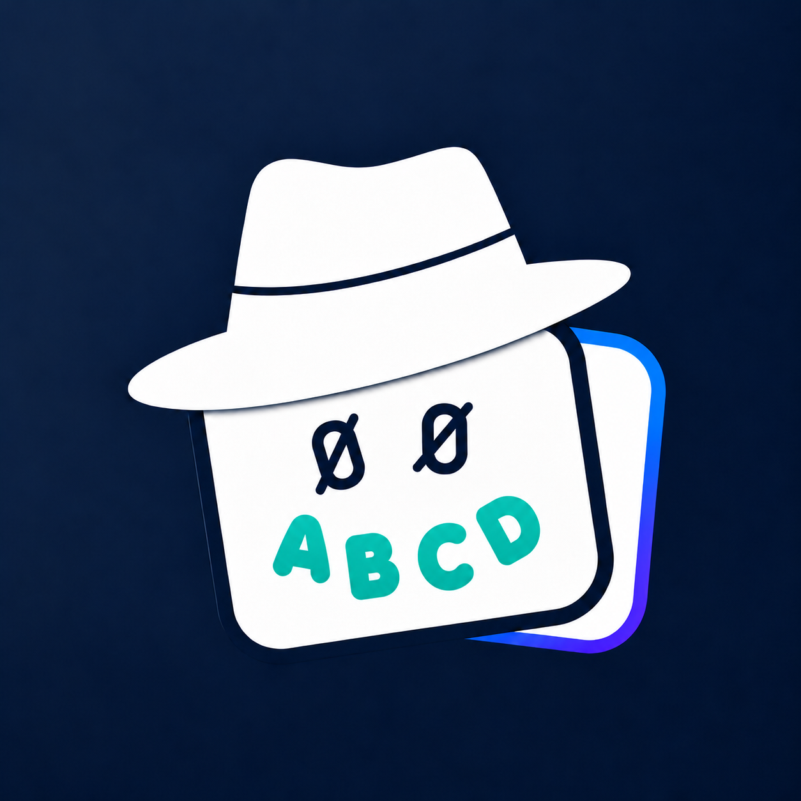
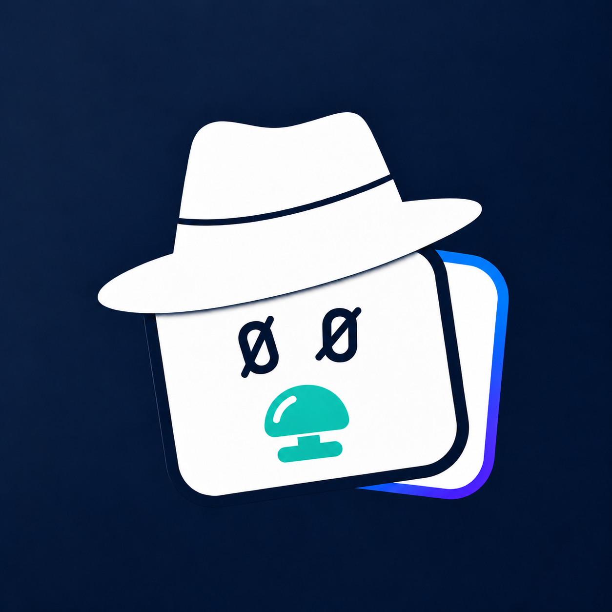
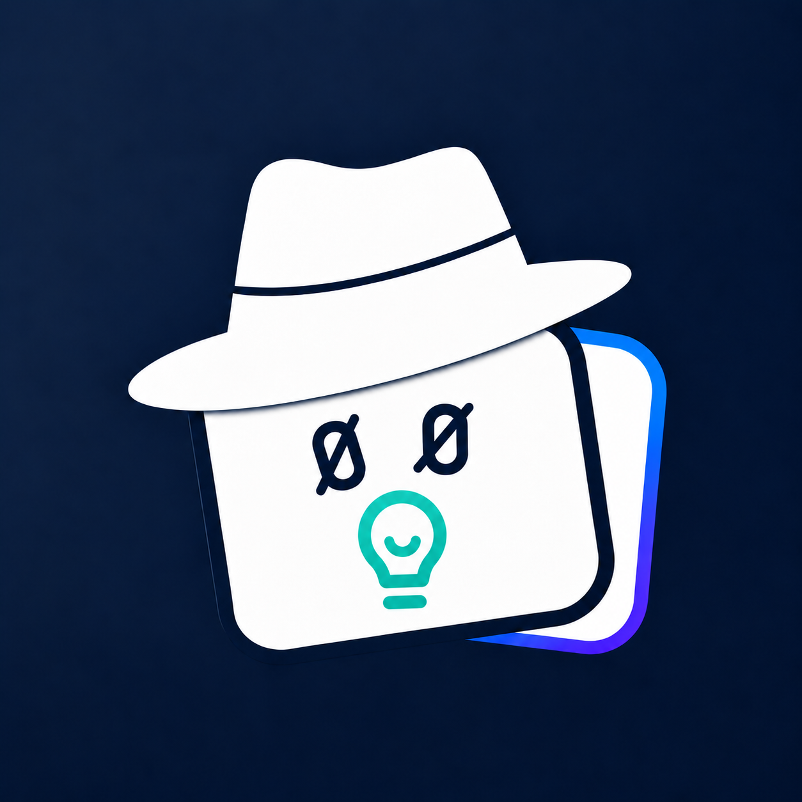

# 00Quiz mouth options

Option 2 (answer bubbles) was selected on 2026-10-17. The production version now has a forest green background and is installed as the iPhone/App Store icon and both in-app brand marks. These images preserve the original navy concepts; the other four options remain unselected. See `../README.md` for the current master and background-edit prompt. `ios/scripts/generate-brand.py` packages its sizes without changing the artwork.

Generated with the built-in image_gen tool. Edit target: the approved original 00Widget app icon at `../00todo/docs/brand/sources/00widget-app-icon-master.png`, relative to the 00Quiz repository root. The request changes only the mouth, keeping the fedora, slashed-zero eyes, layered cards, rim, shading, framing, and navy background.

## 1. Question mark


### Exact generation prompt

```text
Use case: precise-object-edit.
Asset type: preview-only 00Quiz app icon option.
Input image 1 is the EDIT TARGET: the approved original 00Widget icon.
Change ONLY the teal chart-shaped mouth below the two eyes. Remove all five chart bars and restore the pale card underneath, then draw the specified new teal mouth in that same lower-face area. Keep the exact original dark navy gradient square background, white fedora and navy hat band, both navy slashed-zero eyes, two layered white card silhouettes, blue/purple rim, perspective, shading, shadows, framing, scale and placement unchanged. Do not redraw or reinterpret the character. The new mouth must sit comfortably beneath the eyes, align naturally with the tilted card, stay wholly inside the pale front card, and be simple and readable at iPhone icon size. Use the original teal mouth color and the same crisp, lightly dimensional graphic finish. No added facial features, props outside the mouth area, border, labels, watermark, or title. Output one square icon, no presentation mockup, no side-by-side variants.
Mouth option: Replace the chart mouth with a single bold, friendly teal question mark '?' and its round dot, centered below the eyes. Keep it compact, about 165 pixels tall in the original 1254-pixel canvas, with rounded stroke ends. It is the only new mouth element. No smile line or other punctuation.
```

## 2. Answer bubbles


### Exact generation prompt

```text
Use case: precise-object-edit.
Asset type: preview-only 00Quiz app icon option.
Input image 1 is the EDIT TARGET: the approved original 00Widget icon.
Change ONLY the teal chart-shaped mouth below the two eyes. Remove all five chart bars and restore the pale card underneath, then draw the specified new teal mouth in that same lower-face area. Keep the exact original dark navy gradient square background, white fedora and navy hat band, both navy slashed-zero eyes, two layered white card silhouettes, blue/purple rim, perspective, shading, shadows, framing, scale and placement unchanged. Do not redraw or reinterpret the character. The new mouth must sit comfortably beneath the eyes, align naturally with the tilted card, stay wholly inside the pale front card, and be simple and readable at iPhone icon size. Use the original teal mouth color and the same crisp, lightly dimensional graphic finish. No added facial features, props outside the mouth area, border, labels, watermark, or title. Output one square icon, no presentation mockup, no side-by-side variants.
Mouth option: Replace the chart mouth with four equally sized teal answer-selection circles arranged along a shallow U-shaped smiling arc. Make three circles simple bold teal outlines, and make the third circle a filled teal disk with a small clean pale-card-colored check mark. About 330 pixels total width and 90 pixels total height on the original 1254-pixel canvas. No connecting line, no letters, no additional marks.
```

## 3. A–D smile



### Exact generation prompt

```text
Use case: precise-object-edit.
Asset type: preview-only 00Quiz app icon option.
Input image 1 is the EDIT TARGET: the approved original 00Widget icon.
Change ONLY the teal chart-shaped mouth below the two eyes. Remove all five chart bars and restore the pale card underneath, then draw the specified new teal mouth in that same lower-face area. Keep the exact original dark navy gradient square background, white fedora and navy hat band, both navy slashed-zero eyes, two layered white card silhouettes, blue/purple rim, perspective, shading, shadows, framing, scale and placement unchanged. Do not redraw or reinterpret the character. The new mouth must sit comfortably beneath the eyes, align naturally with the tilted card, stay wholly inside the pale front card, and be simple and readable at iPhone icon size. Use the original teal mouth color and the same crisp, lightly dimensional graphic finish. No added facial features, props outside the mouth area, border, labels, watermark, or title. Output one square icon, no presentation mockup, no side-by-side variants.
Mouth option: Replace the chart mouth with four bold, rounded teal capital letters 'A B C D', evenly spaced along a gentle upward-at-the-corners smiling arc, all beneath the eyes. Keep the total word width around 330 pixels and letters around 65 pixels high on the original 1254-pixel canvas. Preserve correct readable letter shapes. Only these four letters form the mouth; no other text, no line, no box.
```

## 4. Quiz buzzer



### Exact generation prompt

```text
Use case: precise-object-edit.
Asset type: preview-only 00Quiz app icon option.
Input image 1 is the EDIT TARGET: the approved original 00Widget icon.
Change ONLY the teal chart-shaped mouth below the two eyes. Remove all five chart bars and restore the pale card underneath, then draw the specified new teal mouth in that same lower-face area. Keep the exact original dark navy gradient square background, white fedora and navy hat band, both navy slashed-zero eyes, two layered white card silhouettes, blue/purple rim, perspective, shading, shadows, framing, scale and placement unchanged. Do not redraw or reinterpret the character. The new mouth must sit comfortably beneath the eyes, align naturally with the tilted card, stay wholly inside the pale front card, and be simple and readable at iPhone icon size. Use the original teal mouth color and the same crisp, lightly dimensional graphic finish. No added facial features, props outside the mouth area, border, labels, watermark, or title. Output one square icon, no presentation mockup, no side-by-side variants.
Mouth option: Replace the chart mouth with a small stylized teal game-show quiz buzzer, centered beneath the eyes. It should be a compact rounded dome with a broad shallow U-curved lower edge that reads as a friendly smile, a short stem, and a small rounded horizontal base. Keep the entire symbol about 270 pixels wide by 125 pixels tall on the original 1254-pixel canvas. Flat/simple graphic treatment, not a photoreal object. No hand, no sound rays, no text, no separate smile.
```

## 5. Lightbulb



### Exact generation prompt

```text
Use case: precise-object-edit.
Asset type: preview-only 00Quiz app icon option.
Input image 1 is the EDIT TARGET: the approved original 00Widget icon.
Change ONLY the teal chart-shaped mouth below the two eyes. Remove all five chart bars and restore the pale card underneath, then draw the specified new teal mouth in that same lower-face area. Keep the exact original dark navy gradient square background, white fedora and navy hat band, both navy slashed-zero eyes, two layered white card silhouettes, blue/purple rim, perspective, shading, shadows, framing, scale and placement unchanged. Do not redraw or reinterpret the character. The new mouth must sit comfortably beneath the eyes, align naturally with the tilted card, stay wholly inside the pale front card, and be simple and readable at iPhone icon size. Use the original teal mouth color and the same crisp, lightly dimensional graphic finish. No added facial features, props outside the mouth area, border, labels, watermark, or title. Output one square icon, no presentation mockup, no side-by-side variants.
Mouth option: Replace the chart mouth with a single compact bold teal outline lightbulb, centered beneath the eyes, with a tiny shallow U-shaped smiling filament inside and a simple two-line base. Keep the complete bulb about 150 pixels wide and 175 pixels high on the original 1254-pixel canvas. Rounded stroke ends and very simple geometry. No rays, sparkles, extra dots, or additional smile outside the bulb.
```
